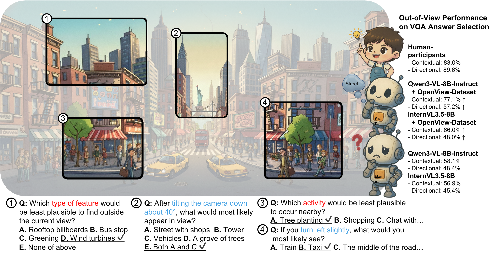

<h1 align="center"><strong>OpenView: Empowering MLLMs with Out-of-view VQA</strong></h1>

<p align="center">
    <a>Qixiang Chen</a><sup>1</sup>,
    <a>Cheng Zhang</a><sup>1</sup>,
    <a>Chi-Wing Fu</a><sup>2</sup>,
    <a>Jingwen Ye</a><sup>1</sup>,
    <a>Jianfei Cai</a><sup>1</sup>
</p>

<p align="center">
    <sup>1</sup>Monash University,
    <sup>2</sup>The Chinese University of Hong Kong
</p>

<p align="center">
    <strong>NeurIPS 2026 · Evaluations &amp; Datasets Track</strong>
</p>

<p align="center">
    <a href="https://arxiv.org/abs/2512.18563">📄 Paper</a>  |
    🌐 Project Page (coming soon)  |
    <a href="https://huggingface.co/datasets/openview2026/OpenView_data">🤗 Dataset &amp; Benchmark</a>
</p>

<p align="center">
  
</p>

In this work, we study **out-of-view understanding**, which requires models to integrate visible cues with contextual priors to reason about content beyond the captured image frame. We introduce **OpenView**, a pipeline that constructs visual question–answer pairs from panoramic images, along with **OpenView-Dataset**, containing over 158K training questions, and **OpenView-Bench**, comprising 1,155 manually verified evaluation questions. Evaluation on **OpenView-Bench** reveals limitations in existing multimodal models’ ability to reason about unseen content, while training on **OpenView-Dataset** consistently improves out-of-view reasoning across the evaluated models.

## Quick Start

1. Download annotations and prepare source panoramas: see [Data Preparation](docs/data_preparation.md).
2. Run a supported model on OpenView-Bench: see [Inference](docs/inference.md).
3. Evaluate predictions: see [Evaluation](docs/evaluation.md).

To construct new VQAs from panoramas, follow the [OpenView Pipeline](docs/pipeline.md) instructions.

## Citation

If you find OpenView useful or relevant to your research, please consider citing our paper 😊

```bibtex
@article{chen2025openview,
  title={OpenView: Empowering MLLMs with Out-of-view VQA},
  author={Chen, Qixiang and Zhang, Cheng and Fu, Chi-Wing and Ye, Jingwen and Cai, Jianfei},
  journal={arXiv preprint arXiv:2512.18563},
  year={2025}
}
```

## Acknowledgement

We thank the [vLLM](https://github.com/vllm-project/vllm) team for their efficient inference engine, which powers our data construction pipeline. We also thank the authors of the panorama datasets used to build OpenView: [360Loc](https://github.com/HuajianUP/360Loc), [360+x](https://x360dataset.github.io/), [360-1M](https://github.com/MattWallingford/360-1M), [Mapillary](https://www.mapillary.com/), and [Matterport3D](https://niessner.github.io/Matterport/).

## License

The code is released under the [MIT License](https://opensource.org/licenses/MIT). The OpenView annotations follow the license specified in our [Hugging Face repository](https://huggingface.co/datasets/openview2026/OpenView_data); source images remain subject to the terms of their original providers.